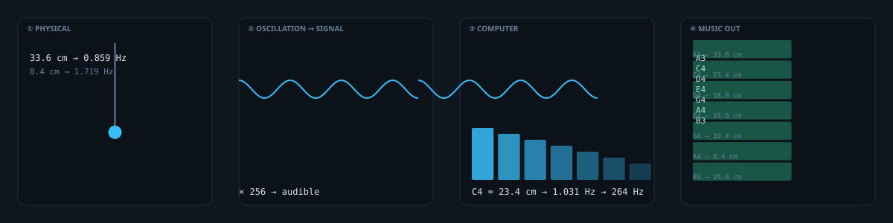

# Pendulum sonification

An ideal pendulum swinging at about 1 Hz, resampled **256×** into the audible range and
played back as music. Motion, sampling, frequency estimation and sound — the same
mathematics at every step.

**▶ [dushmilan.github.io/pendulum-sonification](https://dushmilan.github.io/pendulum-sonification/)**

The page runs on its own, silently, until you click. One click starts the sound and it
keeps going.

## What it shows

A pendulum's angular displacement is

    θ(t) = θ₀ · cos(ωt),    ω = √(g/L)

so the rod's length is what sets its frequency. A computer samples that motion,
estimates the frequency, and plays the estimate back. One full swing is one note, so the
picture on screen and the tone in the air are the same function rather than two things
drawn to look alike.

The strip beneath the four panels is the score: sixteen notes, **13.54 s**, resolving
onto its own first note.

## The 256× step

A desktop pendulum is a few hundred times too slow to hear. A 24 cm rod swings at
1.0175 Hz; the lowest piano note is 27.5 Hz and would need a 0.33 mm rod. So the signal
is resampled ×256 — ordinary sample-rate change, which preserves pitch ratios exactly and
is the reason a melody survives the trip.

| Note | Ratio | Sound | Swing | Rod |
|------|-------|-------|-------|-----|
| A3 | 1/1 | 220.00 Hz | 0.859 Hz | 33.6 cm |
| C4 | 6/5 | 264.00 Hz | 1.031 Hz | 23.4 cm |
| E4 | 3/2 | 330.00 Hz | 1.289 Hz | 15.0 cm |
| A4 | 2/1 | 440.00 Hz | 1.719 Hz | 8.4 cm |

The score is just intonation over A3 = 220 Hz, so the intervals are exact whole-number
ratios rather than equal-tempered approximations.

## What this does and does not claim

- **Damping is not modelled.** A pendulum that swings forever has no energy source. Real
  ones decay, which is why clock pendulums need an escapement. This is an ideal,
  undamped oscillator, shown for clarity.
- **The audio is a resampling, not a recording.** ×256 is sample-rate change. What you
  hear is a sonification of sampled motion.
- **Small-angle approximation.** Amplitude is 0.36 rad (about 20.6°). Beyond roughly
  0.4 rad the true period lengthens and a pure sinusoid stops describing the swing.
- **The apparatus is not built.** Rod lengths are those a physical build would require.

## Running it

No dependencies and no build step.

    npm test      # the whole suite, on node --test
    npm run hero  # regenerate the theme-aware SVG from the same physics module

Then open `index.html` — or serve the directory, since ES modules need HTTP rather than
`file://` in some browsers.

## How it is put together

    src/physics.js     the maths; no DOM, no audio, no canvas
    src/ring.js        fixed-capacity history buffers — the page runs for days
    src/score.js       the note line and loop indexing
    src/scheduler.js   audio-clock lookahead scheduling
    src/audio.js       Web Audio, with the context injected so it can be tested
    src/render.js      canvas 2D: state in, pixels out
    src/main.js        wiring only
    tools/build-hero.mjs   generates assets/ from src/physics.js

Once sound is on, note timing is driven by `AudioContext.currentTime` through a
lookahead scheduler pumped by a timer rather than by `requestAnimationFrame`, so a tab
left open for hours does not drift, and a still picture under `prefers-reduced-motion`
still keeps time. Browsers throttle hidden-tab timers to about once a second, which the
1.5 s lookahead covers; if a tab is hidden long enough to outlast that, the line resumes
at the present instead of firing the missed notes as a burst.

`src/physics.js` is imported by both the page and the hero generator, so the SVG cannot
drift from the demo.

## Licence

MIT.
